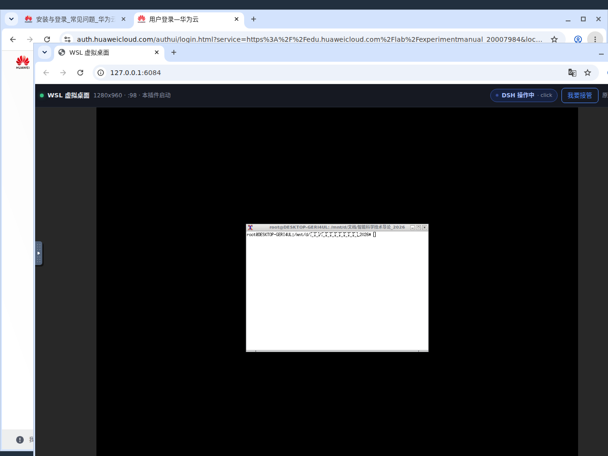
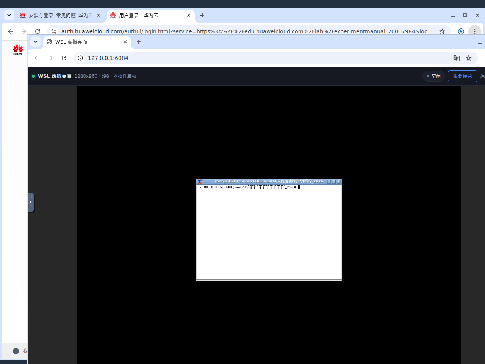

# dsh-computer-use-wsl

给 [DeepSeek Harness](https://github.com/deepseek-ai/deepseek-harness) 用的 **WSL / 无头 Linux 桌面 computer use 插件**：
模型通过 MCP 工具看屏幕、点鼠标、敲键盘；人在侧边栏里实时看到同一块画面，模型操作时顶部显示「**DSH 操作中**」，随时可以点「**我要接管**」抢回鼠标键盘。

```
DSH (Windows 或 WSL 内)
        │  MCP stdio（官方 dsh-mcp-client 桥接，工具名 mcp__wslcu__*）
        ▼
  mcp/server.mjs ──── bash -s（脚本走 stdin，不经 argv）────┐
        │                                                   │
        │                                       ┌───────────▼───────────┐
        │                                       │ Xvfb :99 (1280x960)   │
        │                                       │  └ openbox            │
        │                                       │  └ 你的 GUI 应用       │
        │                                       │ x11vnc :5900          │
        │                                       │  └ websockify :6080   │
        │                                       └───────────┬───────────┘
        │                                                   │
        └──── viewer shell :6081（iframe 内嵌 noVNC + 状态胶囊 + 接管按钮）◄── 侧边栏
```

## 为什么需要它

> 生态里已有的 Computer Use 插件（如 [dsh-computer-use-win](https://github.com/Yu-tao-Li/dsh-computer-use-win)、
> [gxpppp/dsh-computer-use](https://dsh-plugin.org/plugins/gxpppp/dsh-computer-use)、
> [anionex/dsh-computer-use](https://github.com/anionex/dsh-computer-use)）都是**直接驱动宿主真实桌面**。
> 需要"隔离桌面 + 侧边栏可见 + 人来接管"时没有现成方案，这就是本插件的定位。
> 完整对比见 [docs/investigation.zh.md](docs/investigation.zh.md)。

生态里已有的 WSL 插件都只解决「**执行**」或「**运行位置**」：

| 插件 | 能做什么 | 与本插件的关系 |
|---|---|---|
| `dsh-wsl-workspace` / `dsh-wsl-native` | 在 GUI 里用 WSL 工作区 / 把 DSH 跑在 WSL 里 | 不管 GUI 桌面 |
| `dsh-wsl-tool` | 模型经 `wsl.exe` 跑 Linux 命令 | 只有命令，没有「看/点/接管」 |
| `dsh-computer-use-win` | 驱动**真实 Windows 桌面**（UIA） | 平台不同、桌面不同，二者互补 |
| `dsh-computer-use` (macOS) | 无障碍树 | 平台不同 |

没有插件同时做到：**隔离虚拟桌面 + computer use 工具 + 侧边栏实时显示 + 人工随时接管 + 操作状态提示**。这个插件补的就是这一格。

## 安装（Windows 宿主）

前置：Windows 10/11 + WSL2 + 一个装了 X 组件栈的发行版（`bootstrap` 工具可代装）。

```bash
# 在 DSH 所在的机器上
dsh plugin add ./dsh-computer-use-wsl-0.1.6.tgz
```

重启 DSH 后，模型侧出现 17 个 `mcp__wslcu__*` 工具。回滚：

```bash
dsh plugin remove dsh-computer-use-wsl
```

## 快速开始

```
health                      # 看 transport / 显示器 / 端口 / viewerUrl
desktop_up                  # 幂等启动（已在跑的桌面会被复用，不会被重启）
launch  xterm -e bash       # 起一个 GUI 应用（别用裸 "cmd &"，见下）
snapshot                    # 得到 PNG 路径，用 read_image 看
click   {x: 300, y: 200}    # 点
type_text {text: "你好"}     # 中文自动走剪贴板
key     {keys: ["ctrl","s"]}
takeover {action: "start"}  # 人工接管（模型输入会 fail-closed）
desktop_down                # 只停自己起的进程
```

把 `health` 返回的 `viewerUrl` 放进侧边栏（模型可直接调 `sidebar_open`），人就能边看边接管。

## 侧边栏视图与「DSH 操作中」

外壳页由 MCP server 自己托管（不依赖宿主路由 API），因此任何能打开 `http://127.0.0.1:6081/` 的地方都能用。

模型正在操作时，右上角是蓝色的「**DSH 操作中 · click**」（带当前工具名）：



没有动作时是灰色的「空闲」，点「我要接管」变橙色「你正在操作」：



| 状态 | 触发 | 胶囊文案 | 模型输入 |
|---|---|---|---|
| `idle` | 无动作 | 空闲 | 允许 |
| `agent` | 任一输入类工具执行 | **DSH 操作中**（脉冲 + 工具名） | 允许 |
| `user` | 点「我要接管」或 `takeover start` | **你正在操作** | **拒绝**（`USER_IN_CONTROL`） |

`agent` 状态有一个 hold 窗口（默认 3s），每次动作刷新，避免胶囊闪烁。接管 POST 需要页面内的一次性 token，跨站请求会被 403。

## 工具

| 工具 | 作用 |
|---|---|
| `health` | 只读：transport、显示器、端口、就绪状态、viewerUrl、当前控制状态 |
| `control_state` | 只读：**谁在操作**（跨实例共享，接管后所有实例都看得到） |
| `desktop_up` / `desktop_down` | Xvfb + WM + x11vnc + websockify 生命周期（幂等、带归属追踪） |
| `bootstrap` | 显式安装 X 组件栈 |
| `launch` | 后台启动 GUI 应用并确认存活（WSL 会回收裸 `&`） |
| `snapshot` / `windows` / `wait_window` | 观察 |
| `click` / `move` / `drag` / `scroll` / `type_text` / `key` | 输入（接管期间全部拒绝） |
| `takeover` | 人工接管开关 |
| `exec` | 在发行版内跑命令（默认关闭 + 危险命令固定拒绝） |

## 配置

| 键 | 默认 | 说明 |
|---|---|---|
| `transport` | `''`（自动） | `wsl` = Windows 侧驱动发行版；`local` = 在发行版内直接跑 |
| `distro` / `user` | `''` | 空 = WSL 默认发行版 / 默认用户 |
| `display` | `:99` | X display |
| `resolution` | `1280x960` | 4:3，适配侧边栏窄栏 |
| `vncPort` / `webPort` / `viewerPort` | `5900` / `6080` / `6081` | 被占会自动向上探测 |
| `screenshotDir` / `stateDir` | `~/.cache` 派生 / `/tmp/wslcu` | 均在 Linux 侧 |
| `bindHost` | `127.0.0.1` | 仅回环 |
| `agentStateHoldMs` | `3000` | 「DSH 操作中」的保持时间 |
| `startHeldByUser` | `false` | `true` = 启动即由人持有，agent 必须等「交还给 DSH」才能操作 |
| `allowExec` | `false` | 是否允许 `exec` |
| `failOnStartupError` | `false` | 后端挂了不影响 DSH 启动 |

## 安全边界

- 三个服务默认只绑回环；VNC 每次启动生成随机口令。
- `desktop_down` **只停自己启动的进程**：复用你已经在看的桌面时（`owned:false`），不会杀它。
- 接管期间所有 mutating 工具 fail-closed，观察类工具保持只读可用。
- `exec` 默认关闭；即使打开，破坏性命令（`rm -rf /`、`mkfs`、`dd of=/dev/*`、`shutdown` 等）固定拒绝。

## 测试

> 发布产物装进官方 DSH 之后的组合验收记录（版本、SHA-256、--dump-config 片段）：[docs/verify-log.md](docs/verify-log.md)。

```bash
npm test                      # L0 纯逻辑
node mcp/server.mjs --self-test
node test/mcp-handshake.mjs   # L1 MCP 协议
node test/e2e.mjs             # L2 后端 e2e（专用 :98，不碰你的 :99）
node test/viewer-state.mjs    # L2b 视图状态机 + SSE
node test/transport-stub.mjs  # L4 宿主模式（假 wsl.exe）
node test/bundle-patch.mjs    # L5 真实组合：用 DSH 官方 entryListSchema + applyEntryPatches
node test/client-module.mjs   # L6 客户端模块契约（设置卡注册）
scripts/verify.sh             # 全部
```

L2/L2b/L4 需要 Linux X 栈（Xvfb、xdotool、imagemagick、xclip），在发行版内跑。
L5 需要本机装有 DSH（找不到时自动 SKIP，不报错）。

## 已知边界

- 首次使用需要 `bootstrap`（或手工装 X 组件），`desktop_up` 不会偷偷装包。
- 没有窗口管理器也能工作（点击/输入仍然可用），但部分应用在无 WM 下行为怪异；`desktop_up` 有 openbox 就会起。
- 纯 Linux 宿主不需要 `wsl.exe`：`transport` 会自动判为 `local`。

## 许可

MIT。第三方组件（x11vnc / noVNC / websockify / xdotool / ImageMagick / xclip）不随本包分发，见 [THIRD_PARTY.md](./THIRD_PARTY.md)。
